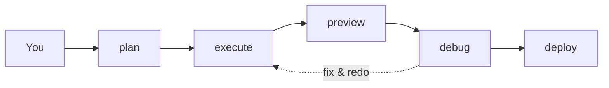

<div align="center">

<!-- Linguistic Languages for README are placed here. Must be redirected to that Lingual README. -->

# Cubicore

Cubicore is a Dynamic Multi-Agentic Factory of Sub-agents tasked to make a project, utilizing the Decrease-and-Conquer Technique to split a large prompt into multiple tasks, where one task is given to each sub-agent.

<p align="center">
  <a href="https://www.npmjs.com/package/cubicore"></a>
  <a href="https://www.npmjs.com/package/cubicore"></a>
  <a href="https://img.shields.io/badge/node-%3E%3D18-brightgreen"></a>
  <a href="LICENSE"></a>
</p>

`npx cubicore@latest setup`

</div>

---

What if you wished to make a "company" right at home, where you are the founder of the project, and your fellow sub-agents do the work for you? Cubicore does that for you. It is an MCP having commands required to finish your project, quicker.

## Introduction

Cubicore is originated as "Cores in a Cubicle", and informally, "A Fleet of Engineers in a Company". The "Cubicle" in this idea is Dynamic, which increases its size dynamically, depending on the plan on the **size of the project**.

The Core philosphy it presents is simple: Suppose a user gives a prompt to the "Cubicle". The "Cubicle" changes its size according to what the user said about. The size stops increasing when the planning is done, and all is left is to wait for the user to "execute" the plan.

This upon execution will summon sub-agents, where 1 task is recieved by 1 agent. This eventually fills up the "Cubicle" where all tasks are done simultaneously. The execution is done where all sub-agents have completed their tasks provided in the planning file.

Cubicore can debug any broken layout, buttons, syntax errors, loose code, etc. and fix them automatically until issues disappear. Cubicore also allows the user to "preview" its project to see how it runs. Finally, if the user satisfies with the project, it then commands the "Cubicle" to deploy the application, making things ready while also giving instructions on how to deploy.

## Supported AI Agents

| AI Agent        | Status | Progress                                                               |
|-----------------|--------|------------------------------------------------------------------------|
| Opencode        | ✅     | Done Further token reduction and Optimize productivity of sub-tasks.   |
| Claude Code     | ⏰     | Will be implementing Inline Sub-tasks. Not Started.                    |
| Codex           | ⏰     | Has Inline-Sub tasks; Needs Further token reduction. Not Started.      |
| Cursor          | ⏰     | Uses Sessions; Tedious to implement as first Session-only integration. |
| Windsurf        | ⏰     | May use Inline Sub-tasks or Sessions. Not Started.                     |

Want to add host support, a command, or translations of this README into other languages? See [CONTRIBUTING.md](CONTRIBUTING.md) — it covers what each kind of contribution needs to look like before it merges.

## Architecture

<p align="center">
  
</p>

The five core commands, one loop: **plan → execute → preview → debug → deploy**. `refine` is the companion for changing the plan without re-running everything (basically editing a project).

The plan stage lets the agent to plan what would be the recommended styles, frameworks or software to fit this project. 

Execute unleashes sub-tasks according to CUBICORE_PLAN.md file. Preview lets you see the changes the agent has made on the web application (by localhost), or on software/CLI/TUI tools (by local binary). 

Debug fixes your code wherever if the position is incorrect, or the button cannot be interacted, as it can utilize the agent's built-in skills. Finally, Deploy marks the final state to publish your project either from a Free or a paid tier service.

The brief process of the Cubicore workflow is shown below.

<details>
<summary>The brief process</summary>



</details>


## Using Cubicore

Ask in plain words. No spec, no schema. The planner reads the repo, asks you what it can't answer, writes `CUBICORE_PLAN.md` / `CUBICORE_PLAN.json` / `CUBICORE_CONTEXT.md`, and stops — nothing dispatches until you approve.

Examples: [`docs/examples.md`](docs/examples.md) · Full reference: [`docs/commands.md`](docs/commands.md) · FAQ: [`docs/faq.md`](docs/faq.md)

### Installation

```bash
npx cubicore@latest setup
```

> [!IMPORTANT]
> Currently, the only source of installation is on the README, or as an npm package.


Then in any project directory, type:

```
/cubicore:plan-demo
```

See [OpenCode Installation](opencode/opencode.md) for full installation instructions,
troubleshooting, FAQs, and AI agent installation.

### How the associates are kept apart

Three checks, applied at three different moments — the moment the plan is written, the moment an associate is working, and the moment its work is handed back. None of them trusts the others.

**At plan time**, overlapping write scopes are rejected before a single token is spent. It's a conservative glob intersection: `src/routes/` and `src/routes/users.ts` collide; `src/a.ts` and `src/b.ts` don't. Reporting a collision that doesn't exist costs one re-plan. Missing one costs two associates in the same file, which is worse.

**During the work**, each associate gets its own git worktree and is told its own scope. A worker writing to `src/api/` has no line of sight into `src/ui/`, and the worktree is the enforcement — not the prompt. An associate that strayed is caught when its diff is checked against what was declared. Where git is unavailable, the work happens in the shared tree and Cubicore says so plainly.

**After the work**, the scope gate compares what changed against what was declared. Over-powered edits are refused; unchecked edits are unverified, which is not the same as passing; a check that couldn't run is recorded as unavailable rather than an error to be fixed.

One housekeeping detail: OpenCode cannot restrict agents to paths. Its permission system is per-action, not per path or glob. So the boundary is never a rule — it's the worktree, plus everything after it.

## What Cubicore is for

Cubicore takes a real project and splits it into **contracts** — small, checkable pieces — and dispatches those pieces to associates that work in parallel without colliding. It earns its keep in these situations:

- **Multi-file changes in an existing codebase**, where one agent would need the whole tree in context at once and still miss things.
- **Founders who want to review a plan before anything gets built** — the plan is the product, and you get to veto it.
- **Work where "done" has a definition** — a build that compiles, a test that passes, a lint that is clean. Vague asks don't fit through the contract layer well, and that's deliberate.

Cubicore is not a faster agent. Speed is whatever the task, the host, and the model make of it. The value is that parallel agents stay safe and auditable: everyone reads only what they're assigned, nobody overwrites anybody by accident, and the result of the run is a record of what passed each check — not a model's opinion of itself.

## What Cubicore does — and what it doesn't

- **It plans.** `CUBICORE_PLAN.md` for you, `CUBICORE_PLAN.json` for the associates, `CUBICORE_CONTEXT.md` for the pitch. Review before dispatch; nothing happens until you approve.
- **It dispatches.** Inline sub-agents where the host supports them, sessions otherwise — both are gated the same way. The session path speaks to OpenCode 2.x's `/api/*` endpoints; the v1 SDK it originally used has been retired by the host.
- **It gates.** Each associate gets its own worktree; its writes are copied back only after the checks pass. A scope violation or a failing check blocks integration — it never slips through silently.
- **It loops, bounded.** Plan → execute → debug → execute, and the number of cycles is capped. "Until the debug file is empty" is not a termination condition; an agent that never stops finding things to fix is not a loop, it's a haunting.
- **It is judgemental only where it's safe to be.** Warnings block work. Opinions about whether the feature is useful go in advisory notes that never gate anything.

What it doesn't do: no judgment in the checks (the validator rejects them), no unattended autonomy, no silent merges. Mechanical gates only — a worker that edits outside its scope or fails a check keeps its work in its own worktree and gets nothing.

## Known limits

- **The gate is mechanical, not judgemental.** It checks commands, statuses and scopes. It cannot tell you your build is bad — only that the check failed.
- **The shell is still unrestricted.** A worker can run anything. The worktree limits the blast radius, not the command.
- **Benchmarks do not exist yet.** No honest Cubicore-vs-one-agent number has been published; the measurements taken so far are not comparative. Until there is one, the honest answer to "is it faster/cheaper?" is "it depends, and we're not going to guess."
- **Only OpenCode runs today.** Every claim in this file is about OpenCode. Assume nothing about other agents until their adapter exists.
- **It runs on what's installed.** Cubicore doesn't bring a runtime; it uses the host's. It doesn't manage your toolchain, and it won't pretend otherwise.

---

## Contributing

Hello there, incoming contributors! Do support us in adding or improving a feature or command, or support Cubicore into an AI agent, or provide another language for the README, or potentially unseen bug fixes or optimizations. More info under [contributing guidelines](CONTRIBUTING.md).