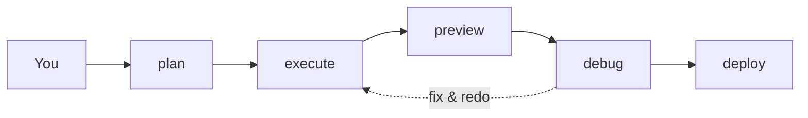

<div align="center">

<!-- Linguistic Languages for README are placed here. Must be redirected to that Lingual README. -->

# Cubicore

</div>

Cubicore is a Dynamic Multi-Agentic Factory of Sub-agents tasked to make a project, utilizing the Decrease-and-Conquer Technique to split a large prompt into multiple tasks, where one task is given to each sub-agent.

---

What if you wished to make a "company" right at home, where you are the founder of the project, and your fellow sub-agents do the work for you? Cubicore does that for you. It is an MCP having commands required to finish your project, quicker.

## Introduction

Cubicore is originated as "Cores in a Cubicle", and informally, "A Fleet of Engineers in a Company". The "Cubicle" in this idea is Dynamic, which increases its size dynamically, depending on the plan on the **size of the project**.

The Core philosphy it presents is simple: Suppose a user gives a prompt to the "Cubicle". The "Cubicle" changes its size according to what the user said about. The size stops increasing when the planning is done, and all is left is to wait for the user to "execute" the plan.

This upon execution will summon sub-agents, where 1 task is recieved by 1 agent. This eventually fills up the "Cubicle" where all tasks are done simultaneously. The execution is done where all sub-agents have completed their tasks provided in the planning file.

Cubicore can debug any broken layout, buttons, syntax errors, loose code, etc. and fix them automatically until issues disappear. Cubicore also allows the user to "preview" its project to see how it runs. Finally, if the user satisfies with the project, it then commands the "Cubicle" to deploy the application, making things ready while also giving instructions on how to deploy.

## Supported AI Agents

Currently, we only support Opencode for now.

| AI Agent        | Status | Progress                                                               |
|-----------------|--------|------------------------------------------------------------------------|
| Opencode        | ✅     | Done Further token reduction and Optimize productivity of sub-tasks.   |
| Claude Code     | ⏰     | Will be implementing Inline Sub-tasks. Not Started.                    |
| Codex           | ⏰     | Has Inline-Sub tasks; Needs Further token reduction. Not Started.      |
| Cursor          | ⏰     | Uses Sessions; Tedious to implement as first Session-only integration. |
| Windsurf        | ⏰     | May use Inline Sub-tasks or Sessions. Not Started.                     |

Want to add host support, a command, or translations of this README into other languages? See [CONTRIBUTING.md](CONTRIBUTING.md) — it covers what each kind of contribution needs to look like before it merges.

## Architecture

<p align="center">
  
</p>

The five core commands, one loop: **plan → execute → preview → debug → deploy**. `refine` is the companion for changing the plan without re-running everything (basically editing a project).

The plan stage lets the agent to plan what would be the recommended styles, frameworks or software to fit this project. 

Execute unleashes sub-tasks according to CUBICORE_PLAN.md file. Preview lets you see the changes the agent has made on the web application (by localhost), or on software/CLI/TUI tools (by local binary). 

Debug fixes your code wherever if the position is incorrect, or the button cannot be interacted, as it can utilize the agent's built-in skills. Finally, Deploy marks the final state to publish your project either from a Free or a paid tier service.

The brief process of the Cubicore workflow is shown below.

<details>
<summary>The brief process</summary>



</details>

---

## Using Cubicore

Ask in plain words. No spec, no schema. The planner reads the repo, asks you what it can't answer, writes `CUBICORE_PLAN.md` / `CUBICORE_PLAN.json` / `CUBICORE_CONTEXT.md`, and stops — nothing dispatches until you approve.

Examples: [`docs/examples.md`](docs/examples.md) · Full reference: [`docs/commands.md`](docs/commands.md) · FAQ: [`docs/faq.md`](docs/faq.md)

---

### Installation

```bash
npx cubicore@latest setup
```

> [!IMPORTANT]
> Currently, the only source of installation is on the README, or as an npm package.


Then in any project directory, type:

```
/cubicore:plan-demo
```

See [OpenCode Installation](opencode/opencode.md) for full installation instructions,
troubleshooting, FAQs, and AI agent installation.

### How the associates are kept apart

Three layers, and only the first was ever airtight.

**At plan time**, the validator rejects overlapping write scopes before a token is spent. It is a conservative over-approximation — `src/routes/` and `src/routes/users.ts` collide, `src/a.ts` and `src/b.ts` do not — because over-reporting costs one re-plan while under-reporting costs a merge conflict.

**During the work**, each associate gets its own git worktree, so two workers cannot be in one file at the same moment. The session is created and prompted there, and the contract's declared writes are copied back only after its checks pass. Because the scopes are disjoint, that copy cannot conflict. Where git is unavailable the isolate degrades to the shared tree and says so.

**After the work**, the scope gate checks what actually changed against what was declared. A worker that strayed is caught, and a check that could not run at all is reported as unverified rather than as a failure — no evidence either way, and not retryable, because a revision cannot install a missing dependency.

opencode 1.18.x cannot restrict an agent to a path — its permissions are per-action, not per-resource — so the filesystem is the only boundary available.

## What Cubicore is for

Cubicore splits a real project into **contracts** — independent, checkable pieces of work — and dispatches them so they can run without colliding. It's for:

- **Multi-file changes in an existing codebase** — where a single agent would stumble.
- **Founders who want a plan reviewed before anything is built** — not an assistant guessing at the goal.
- **Verification that means something** — scope gates, check matrix, worktree isolation, and a bounded fix loop. Not a model saying "done".

It is **not** a faster lane. There is no published efficiency number. It is not obviously cheaper than one agent on small tasks, and on some host/model combinations it isn't. What the contract layer does reliably is make parallel agents safe and auditable — the speedup, if any, is what the disjoint split buys on a specific host with a specific model.

## What exists

- **Contracts, not prompts.** Disjoint write scopes, a check matrix computed at validation time, budget caps, and a topology check that refuses work which is not divide-and-conquer.
- **Narrative context.** `CUBICORE_CONTEXT.md` — problem, users, use cases, benefits, demo flow, future work. Written for humans presenting the project; never parsed by Execute or dispatch.
- **Two dispatch paths.** Inline sub-tasks where the host supports them, sessions where it does not. Both gate the same way. The session path speaks to opencode 2.x's `/api/*` endpoints — the v1 SDK it originally used has been retired by the host.
- **One worktree per associate.** The opencode host cannot restrict an agent to a path, so the filesystem is the boundary: two workers cannot be in one file at the same moment. A worker's files are copied back only after its checks pass, so an unapproved change never reaches the shared tree.
- **Eleven commands, and the flow guides itself.** Every reply ends with the next step and the alternatives, derived from the state on disk rather than remembered.
- **A bounded loop.** `plan → execute → debug → execute`, capped at three cycles. Not "until the debug file is empty" — that's an unbounded loop with a terminal case of an agent that never stops finding things to fix.
- **Judgement never blocks.** Errors and warnings block. "Is this useful?" and "is this production ready?" are advisory and left to the founder.

## Known limits

- **The gate is mechanical, not judgemental.** It checks commands, statuses, and scopes. It cannot tell you the build is bad; it can tell you the check failed.
- **No benchmark of Cubicore vs one agent is published.** The naive fan-out burns more tokens for no wall-clock win, but Cubicore vs naive is not a number you can pay attention to without a provisioned model and a holdout task. The figures that circulated were smoke tests, not benchmarks.
- **The inline path's shell is still unrestricted.** A worker can run anything. The worktree contains the damage — a stray file stays in the worker's checkout and is not copied back — but the command still ran.
- **v1 catches mechanical failures only.** No `judgment` checks are admitted; the validator rejects them. Whether a feature is *useful* is not something the matrix can decide.
- **Works on whatever base image the host supports.** Your base system stays yours; Cubicore doesn't touch it.

## Contributing

Hello there, incoming contributors! Do support us in adding or improving a feature or command, or support Cubicore into an AI agent, or provide another language for the README, or potentially unseen bug fixes or optimizations. More info under [contributing guidelines](CONTRIBUTING.md).