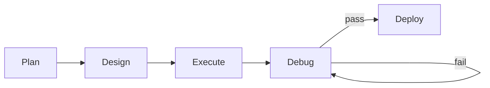

# Cubicore Landing Page — Build Prompt

> **Copy this entire file and paste it into your coding agent.**
> 
> This prompt builds the **Cubicore landing page** — a static site hosted on **GitHub Pages** (`docs/` folder), styled like `.tools` domains (clean, readable, fast).

---

## Project Overview

**Product**: Cubicore — a virtual company that turns a prompt into validated, parallel, contract-driven work.

**Target Audience**: Developers who want parallel, verified, contract-driven development.

**Vibe**: `.tools` domains — clean, readable, fast, no fluff. Think `regex.tools`, `json.tools`, `cron.tools`.

**Hosting**: GitHub Pages → deploy from `docs/` folder.

---

## Site Structure (Single Page, Anchor Navigation)

```
┌─────────────────────────────────────────────────────────────┐
│  Hero: Name + Tagline + CTA (GitHub / Watch Tutorial)              │
├─────────────────────────────────────────────────────────────┤
│  What It Is (2-3 sentences + diagram)                       │
├─────────────────────────────────────────────────────────────┤
│  Features (3-4 cards: Parallel, Verified, Contract-Driven)  │
├─────────────────────────────────────────────────────────────┤
│  Live Demo → tutorial.html (live scripted Cubicore session)      │
├─────────────────────────────────────────────────────────────┤
│  Quick Start (3 commands)                                   │
├─────────────────────────────────────────────────────────────┤
│  How It Works (5 steps: Plan → Design → Execute → Debug → Deploy)        │
├─────────────────────────────────────────────────────────────┤
│  Architecture (diagram: Plan → Execute → Debug → Deploy)        │
├─────────────────────────────────────────────────────────────┤
│  Commands Reference (table)                                 │
├─────────────────────────────────────────────────────────────┤
│  Source Code Link + License                                 │
└─────────────────────────────────────────────────────────────┘
```

---

## Visual Style (`.tools` Aesthetic)

| Property | Value |
|----------|-------|
| **Font** | System UI stack (`-apple-system, BlinkMacSystemFont, 'Segoe UI', Roboto, sans-serif`) |
| **Mono Font** | `ui-monospace, SFMono-Regular, 'Fira Code', monospace` |
| **Background** | `#0a0a0a` (near-black) |
| **Surface** | `#111111` / `#1a1a1a` (cards) |
| **Border** | `#2a2a2a` |
| **Text Primary** | `#e8e8e8` |
| **Text Muted** | `#888888` |
| **Accent** | `#60a5fa` (baby blue) |
| **Accent Hover** | `#93c5fd` (sky blue) |
| **Palette Family** | Sky (`#7dd3fc`) → Baby (`#60a5fa`) → Blue (`#3b82f6`) → Dark royal (`#1e3a8a`) |
| **Border Radius** | `8px` (cards), `4px` (buttons) |
| **Spacing Scale** | `4px` base (`4, 8, 16, 24, 32, 48, 64`) |
| **Max Width** | `800px` (content), `1000px` (code blocks) |
| **Transition** | `150ms ease` |

**Code Blocks**: Dark background (`#0d0d0d`), syntax highlighting (Prism or Shiki), copy button.

**Buttons**:
- Primary: `background: #60a5fa; color: #0a0a0a; font-weight: 600;`
- Secondary: `background: transparent; border: 1px solid #2a2a2a; color: #e8e8e8;`
- Ghost: `background: transparent; color: #888;`

**Animations**: Fade-in up on scroll (IntersectionObserver), button hover scale `1.02`, link underline slide.

---

## Content (Copy-Paste Ready)

### Hero
```
Cubicore
A virtual company that turns a prompt into verified, parallel, contract-driven work.

[GitHub] [Watch the Live Tutorial] [Quick Start]
```

The **"Watch the Live Tutorial"** button links to `tutorial.html` — a fully static, scripted demonstration of the full lifecycle (Plan → Design → Execute → Debug → Deploy) that needs no agent and no build step. See the **Live Demo** section below.

### What It Is
> **Cubicore** turns a prompt into a plan, splits it into independent contracts, runs them in parallel with worktree isolation, gates every contract with mechanical checks, and iterates until the `preview` block passes, then debugs review/test/fix until the remaining issues disappear.
>
> You get: **parallel execution**, **mechanical verification**, **contract-driven scope**, **automatic fix loops**.

### Features (3 Cards)

| Feature | Description |
|---------|-------------|
| **Parallel by Default** | Contracts with disjoint write scopes run simultaneously. No manual orchestration. |
| **Mechanical Verification** | Every contract has blocking, convergent checks (tests, typecheck, lint). No "looks good" — only pass/fail. |
| **Contract-Driven Scope** | Each worker gets its own write scope, read list, and checks. Collisions caught at plan time, not runtime. |
| **Auto-Debug Loop** | Checks fail → `/cubicore:debug` reviews/tests/fixes → re-tests → loops until the failures disappear. |

### Live Demo (`tutorial.html`)

The tutorial is the strongest answer to "what does Cubicore actually do all session?". It is a **self-contained, scripted live demonstration** in the same style as this landing page — no AI agent, no network calls, no build step.

It shows, with realistic terminal playback and artifact inspection:

1. **Planning** — the planner splits a request into disjoint contracts
2. **Designing** — one brief per associate, written to `CUBICORE_ASSOCIATES/`
3. **Executing** — the associates run in parallel and report separately
4. **Debugging** — a check fails, the repair is applied, the re-check passes
5. **Deployment** — the app serves HTTP 200 and a deploy handoff is written

**The tutorial must match this page visually and behaviorally:**

- **Same palette** — `#0a0a0a` background, `#111111`/`#1a1a1a` surfaces, `#60a5fa` accent, `#e8e8e8` text, `#2a2a2a` borders
- **Same motion language** — fade/slide on scroll, `cubic-bezier(.23,1,.32,1)` easing, ~`150–250ms` micro-interactions, `prefers-reduced-motion` respected
- **Same flat, near-black look** — no gradients, no heavy shadows, system UI + monospace
- **Linked, not copied** — the landing page links to `tutorial.html`; the tutorial links back to `index.html` (top-left "← Landing")

**Implementation notes for `index.html`:**

- Add a "Live Demo" card between Features and Quick Start: a small faux terminal preview (3–4 lines of scripted output, e.g. `$ cubicore plan-demo "build a habit tracker"` → `kind: 2 associates, fan-out`), with a primary CTA button **Watch the tutorial →** opening `tutorial.html` in the same tab.
- Hero's **[Watch the Live Tutorial]** button also opens `tutorial.html`.
- Neither page carries build tooling — `tutorial.html` stands alone and must work when opened directly from `file://`.

### Quick Start (3 Commands)
```bash
# 1. Install
npm i -g @cubicore/cli

# 2. Plan
cubicore plan "Build a personal expense tracker API with SQLite"

# 3. Execute
cubicore execute
```

### How It Works (5 Steps)



1. **Plan** — `/cubicore:plan-demo`/`plan-full` researches the repo, asks clarifying questions, writes `CUBICORE_PLAN.json` with disjoint contracts, checks, and a `preview` block.
2. **Design** — Cubicore writes one brief per associate into `CUBICORE_ASSOCIATES/`, with own scope, checks and no cross-reads.
3. **Execute** — Spawns isolated associates in parallel, gates each with Schema → Verify → Scope.
4. **Debug** — Reviews code and runs all contract checks. Failures → minimal fixes → re-run until green (un-fixable warnings/errors are reported).
5. **Deploy** — `/cubicore:deploy` plans hosting, writes configs, explains manual steps.

### Commands Reference

| Command | Purpose |
|---------|---------|
| `cubicore plan "..."` | Research → plan → `CUBICORE_PLAN.json` + `CUBICORE_PLAN.md` |
| `cubicore execute` | Dispatch contracts in parallel, run gates, aggregate |
| `cubicore debug` | Review/test/fix the delivered work until issues disappear |
| `cubicore preview` | Run the delivered thing the way the founder would (web/CLI/TUI/GUI); leave it running |
| `cubicore deploy` | Plan hosting, write configs, explain steps |
| `cubicore refine "..."` | Modify plan, re-dispatch changed contracts |
| `cubicore undo` | Revert last execution to baseline |
| `cubicore status` | Poll run status |
| `cubicore estimate` | Token/wall/time estimate before spend |
| `cubicore undo` | Revert last execution to baseline |

### Source & License
```
Source: github.com/your-org/cubicore
License: MIT
```

---

## Technical Requirements

### Stack
- **Framework**: Vanilla HTML/CSS/JS (no framework) — `index.html` (landing) + `tutorial.html` (live demo), sharing `style.css`
- **Syntax Highlighting**: Prism.js (lightweight) or Shiki via CDN
- **Icons**: Inline SVG (Lucide or custom)
- **No build step** — open either page directly

### Files to Create
```
docs/
├── index.html          # Landing page
├── tutorial.html       # Live scripted Cubicore demo (already exists)
├── style.css           # All styles
├── app.js              # Interactions (scroll spy, copy buttons, theme toggle)
├── favicon.svg         # Cubicore logo
└── assets/
    └── diagram.svg     # Architecture diagram (SVG)
```

### GitHub Pages Deploy
1. Push to `main` branch
2. Settings → Pages → Source: `main` branch, `/docs` folder
2. Custom domain (optional): `cubicore.tools` or `cubicore.dev`

---

## Acceptance Criteria

- [ ] Landing page links to `tutorial.html` (hero CTA + Live Demo card) and back, in both pages
- [ ] `tutorial.html` uses the same palette (`#0a0a0a`, `#60a5fa`), easing, and typography as the landing page
- [ ] `tutorial.html` runs fully standalone from `file://` with no build step or network
- [ ] Loads in < 1s on 3G (Lighthouse Performance > 90)
- [ ] Lighthouse Accessibility > 95
- [ ] Works without JS (content readable, links work)
- [ ] Dark mode only (no light mode toggle needed)
- [ ] Responsive: 320px → 1440px
- [ ] Code blocks: copy button, line numbers, syntax highlight
- [ ] Smooth scroll to anchors, URL updates
- [ ] Reduced motion respected (`prefers-reduced-motion`)
- [ ] Print stylesheet (clean PDF export)
- [ ] `robots.txt` + `sitemap.xml` generated

---

## Deliverables Checklist

- [ ] `docs/index.html` — semantic HTML5, ARIA labels
- [ ] `docs/tutorial.html` — live scripted demo (already exists; keep it, do not rebuild) — must share palette/typography/easing and link back to `index.html`
- [ ] `docs/style.css` — all styles, no framework
- [ ] `docs/app.js` — scroll spy, copy buttons, smooth scroll, theme respect
- [ ] `docs/assets/diagram.svg` — architecture diagram (inline SVG)
- [ ] `docs/favicon.svg` — Cubicore logo
- [ ] `README.md` in repo root links to live site and to the tutorial

---

## Definition of Done

Run this to verify:
```bash
cd docs && npx serve .
# Open http://localhost:3000 — verify landing renders with no console errors
# Open http://localhost:3000/tutorial.html — verify the scripted demo plays end to end
# Click "Watch the Live Tutorial" on the landing page, then "← Landing" on the demo, and confirm both links work
```

---

> **Note to Collaborator**: This is the *entire* spec. Build exactly this. No extra features. Match the `.tools` aesthetic precisely. When done, push to `main` and enable GitHub Pages from `/docs`.

---

*Generated for Cubicore collaborator. Paste into your coding agent and build.*